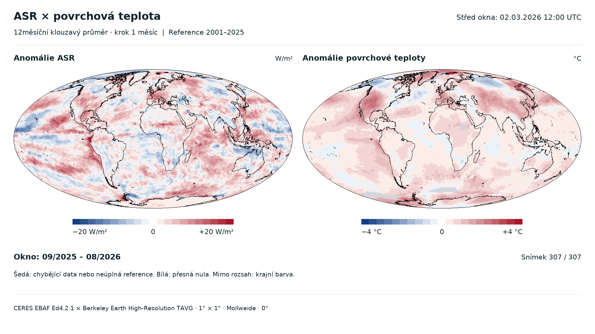

# CERES × Berkeley Earth: interaktivní animace a MP4

**[Otevřít živý atlas](https://nabiknab-eng.github.io/ceres-asr-temperature-atlas/)**

- [Offline atlas a exportní nástroj (ZIP)](https://github.com/nabiknab-eng/ceres-asr-temperature-atlas/releases/download/v2.0.0/ceres_animace_prohlizeni_a_export.zip)
- [Původní měsíční vstupy pro reprodukci (archiv v1.0.0)](https://github.com/nabiknab-eng/ceres-asr-temperature-atlas/releases/download/v1.0.0/ceres_atlas_uplny.zip)
- [Hotové MP4 celého období, 1920 × 1080 / H.264](https://github.com/nabiknab-eng/ceres-asr-temperature-atlas/releases/download/v2.0.0/animace_2000-2026_ASR20_T4_6fps.mp4)
- [Klouzavé anomálie v plné přesnosti (NetCDF)](https://github.com/nabiknab-eng/ceres-asr-temperature-atlas/releases/download/v2.0.0/rolling_anomalies.nc)
- [Všechny přílohy vydání v2.0.0](https://github.com/nabiknab-eng/ceres-asr-temperature-atlas/releases/tag/v2.0.0)

Rozbalte offline ZIP a otevřete `ceres_animace/index.html`. Pro nové MP4 stáhněte z HTML exportní JSON a spusťte doprovodný Python skript. Samotné tlačítko v prohlížeči video nekóduje.

Pro úplnou reprodukci stáhněte nový offline ZIP a archiv vstupů v1.0.0. Z rozbaleného staršího archivu zkopírujte složku `ceres_atlas/raw` do `ceres_animace/original/raw`, nainstalujte `requirements.txt` a spusťte `build_animation.py`. Obě generace atlasu používají přesně stejné vstupní NetCDF, ověřené SHA-256.

Repozitář obsahuje zdroje a všechny bloky pro živý atlas. Velké NetCDF, původní měsíční vstupy a FFmpeg pro Mac jsou v přílohách vydání. Pro reprodukci výpočtů použijte úplný ZIP; pro prohlížení a nový export stačí menší ZIP. Po klonování lze export spustit po instalaci `requirements_export.txt`; Python čte datové bloky z `viewer/`.



# CERES × Berkeley Earth: místní animace a MP4

Otevřete **index.html** v aktuálním Safari, Chrome nebo Firefoxu. Celou složku ponechte pohromadě. Prohlížení funguje přímo ze souborů (`file://`), bez internetu, serveru, instalace nebo CDN. Složka `viewer` obsahuje místní datové bloky; první načtení bloku může krátce trvat, další blok se načítá dopředu. Udržuje se nejvýše pět dekomprimovaných bloků.

K dispozici jsou dva ZIPy: **prohlížení a export** obsahuje vše pro HTML i nové MP4, původní atlas a původní roční / pětileté výsledky; **úplný balíček** navíc obsahuje původní velké měsíční vstupy a plné klouzavé NetCDF pro reprodukci výpočtů. V menším balíčku Python čte zobrazovací data přímo z místních JS bloků jako data, bez spouštění JavaScriptu. Sestavení výsledků od vstupních měsíčních polí vyžaduje úplný balíček.

## Ovládání

- Tři režimy: původních 25 kalendářních roků, 307 měsíčních kroků 12měsíčních průměrů a zachované pětileté průměry.
- Přehrát / pauza, krok zpět / vpřed, časový posuvník, rychlost 0,5–24 snímků/s. Každý krok je jeden další snímek, bez přeskakování měsíců; na konci se přehrávání zastaví.
- Samostatné škály ASR ±5…±40 W/m² (krok 1) a teploty ±1…±7 °C (krok 0,2). Výchozí meze jsou ±20 a ±4. Změna se projeví i během přehrávání.
- Automatická škála se nastavuje pro každou veličinu zvlášť z maxima celé právě zvolené časové řady. Je symetrická, zaokrouhlená nahoru na krok šoupátka a omezená jeho rozsahem. Je stálá během přehrávání. Ruční pohyb šoupátka její automatiku vypne.
- Skutečné maximum klouzavých anomálií je 51,866 W/m² a 7,081 °C. Proto ani nejširší povolená škála neobsáhne všechny extrémy. Přesahy mají krajní barvu; plná výpočetní data nejsou oříznuta.

## Export MP4

V HTML zvolte režim, meze škál, začátek, konec a rychlost videa. Tlačítkem **Export MP4 — stáhnout nastavení** uložte `atlas-export.json`. Oba konce úseku jsou zahrnuty. Nastavení zachytí právě účinné meze i při zapnuté automatice.

Na tomto Macu otevřete **Export_MP4.command**, přetáhněte stažený JSON do otevřeného terminálu a potvrďte Enter. Samotný Enter exportuje výchozí celé měsíční období. Výstup vznikne ve složce `exports`. FFmpeg pro Apple Silicon je přiložen. Závislosti jsou na tomto počítači už připravené; skript je najde ve společném pracovním prostředí. Při přesunu na jiný počítač je potřeba jednou připravit Python 3.12+:

```sh
python3 -m venv .venv
.venv/bin/python -m pip install -r requirements_export.txt
.venv/bin/python export_mp4.py --settings /cesta/k/atlas-export.json
```

Po instalaci závislostí je i export offline. Na jiných platformách lze použít systémový FFmpeg, proměnnou `FFMPEG_BINARY` nebo binární soubor z `imageio-ffmpeg`. Přímé vytváření H.264 MP4 z offline HTML se nespoléhá na proměnlivou podporu kodeků prohlížeče; HTML předá parametry Pythonu prostřednictvím JSON. HTML tlačítko samo video nekóduje.

Výstup: **MP4 / H.264, 1920 × 1080, yuv420p**, konstantní snímková frekvence. Jeden vstupní snímek se zapíše právě jednou. Nastavitelných 0,25–60 snímků/s; doba videa = počet snímků / rychlost. Přiložená hotová ukázka `exports/animace_2000-2026_ASR20_T4_6fps.mp4` má 307 snímků a přibližně 51,17 s. Vedle videa je `.frames.json` s pořadím, přesným středem a hranicemi každého okna. Existující MP4 se nepřepisuje.

## Data a reprodukce

Společné pokrytí je **03/2000–08/2026**, 318 měsíců. CERES končí v srpnu 2026; Berkeley Earth v září 2026. První okno: 03/2000–02/2001, střed 30. 8. 2000 12:00 UTC. Poslední: 09/2025–08/2026, střed 2. 3. 2026 12:00 UTC. Středy nejsou mechanicky zaokrouhlené na první den měsíce. Časový posuvník má jeden krok na každý posun okna o měsíc.

`original/` obsahuje původní atlas, původní vstupní NetCDF, roční i pětileté výsledky a nezměněný reprodukční skript. `data/rolling_anomalies.nc` obsahuje neoříznuté klouzavé anomálie ve float64, reference, časové hranice a počty platných měsíců. Znovu sestavit:

```sh
.venv/bin/python -m pip install -r requirements.txt
.venv/bin/python build_animation.py
```

`build_animation.py` vytváří obě reprezentace ze stejných podkladů. HTML a MP4 používají identické float32 zobrazovací bloky, společnou projekční tabulku, paletu a pobřeží. Ztráta přesnosti pouze zobrazovací kopie je nejvýše 0,00000191 W/m² a 0,000000239 °C; výpočetní NetCDF zůstává float64. H.264 je ztrátový kodek a yuv420p podvzorkuje barevnost, takže dekódované video není bitově totožné s nekomprimovaným plátnem. Přiřazení hodnot, intervalů a barev před kompresí je shodné. Text se může mezi rastrovými enginy lišit ve vyhlazení okrajů znaků.

Podrobnosti v `METHODOLOGY.md`. Kontroly v `validation_computation.json`, `validation_media.json` a `validation_browser.json`. Prohlížeč ani exportní skript nikam neodesílají uživatelská nastavení. Žádný geografický podklad není generován AI.
