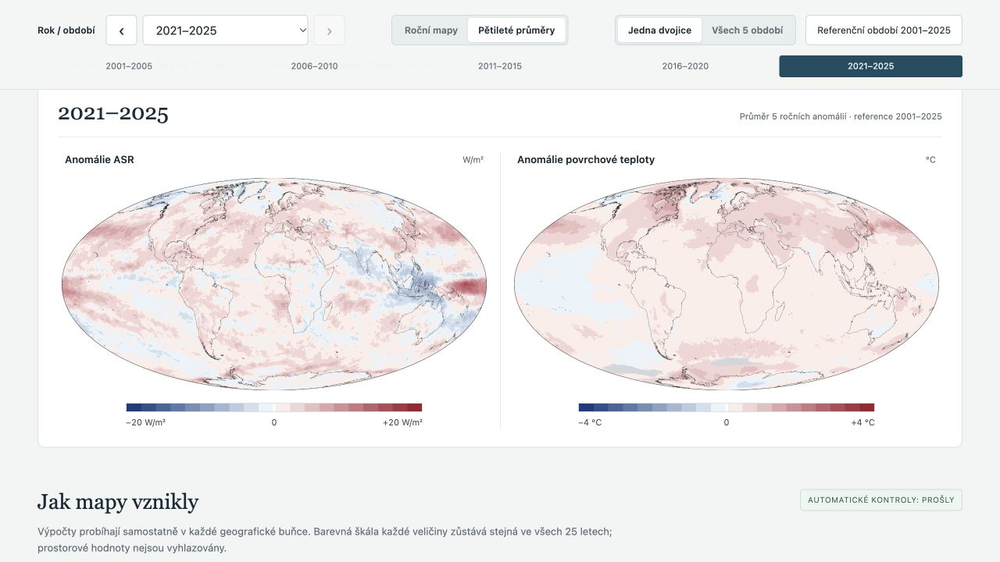

# Globální atlas ASR a povrchové teploty · 2001–2025

Veřejný atlas 25 ročních a 5 pětiletých dvojic globálních map. CERES EBAF-TOA Ed4.2.1 a Berkeley Earth High-Resolution TAVG, společná reference 2001–2025.

## Stažení a otevření

- [Prezentace, mapy, NetCDF a skripty (ZIP)](https://github.com/nabiknab-eng/ceres-asr-temperature-atlas/releases/download/v1.0.0/ceres_atlas_prezentace_a_vysledky.zip) — rozbalte a otevřete `ceres_atlas/index.html`; funguje offline bez serveru.
- [Úplný reprodukční balíček včetně původních vstupních dat (ZIP)](https://github.com/nabiknab-eng/ceres-asr-temperature-atlas/releases/download/v1.0.0/ceres_atlas_uplny.zip).
- [Všechny soubory vydání v1.0.0](https://github.com/nabiknab-eng/ceres-asr-temperature-atlas/releases/tag/v1.0.0).

Zdrojový kód, HTML a lokální mapové obrázky jsou také přímo v tomto repozitáři. GitHub soubor HTML zobrazuje jako zdrojový kód; pro prohlížení atlasu použijte stažený ZIP nebo po klonování otevřete `index.html` v běžném prohlížeči. Velké NetCDF a původní vstupy jsou distribuovány přes Releases.



## Technické informace

**Dokončeno:** 25 ročních a 5 pětiletých dvojic map ASR a teploty, společná síť 1° × 1°, Mollweideovo plochojevné zobrazení s centrálním poledníkem 0°.

Otevřete **index.html** přímo v prohlížeči. Soubory v `assets/` ponechte vedle HTML. Dokument funguje offline, bez serveru a CDN. Ovládání přepíná mezi ročními a pětiletými mapami a nabízí výběr roku/období, předchozí/další položku, přehled celé skupiny a bílý referenční pohled.

## Vstupy

- **NASA CERES EBAF-TOA Edition4.2.1**, skutečné měsíční regionální NetCDF proměnné `solar_mon` a `toa_sw_all_mon`, W m⁻². ASR = příchozí sluneční tok minus odražený krátkovlnný tok. [Oficiální archiv](https://search.earthdata.nasa.gov/search/granules?p=C3880497643-LARC_CLOUD).
- **Berkeley Earth High-Resolution global TAVG, oficiální 1° varianta**, soubor vytvořený 29. 10. 2026. Tato předběžná generace byla výslovně schválena jako náhrada ukončeného původního produktu. Celé období používá stejnou generaci. [Oficiální zdroj](https://berkeleyearth.org/data/). Nad mořským ledem se extrapolují anomálie teploty vzduchu z pevniny; nad otevřeným oceánem jde o teplotu povrchu moře.
- **Natural Earth 50m coastline, 4.1.0** podle staženého VERSION.txt; bez hranic států.

## Výpočet a škály

ASR je pohlcený sluneční tok soustavy Země–atmosféra. Platí **ASR = F_in (1 − α)**, kde α je planetární albedo definované jako podíl odraženého a příchozího krátkovlnného toku pro stejnou oblast a období (při F_in > 0). **Při stejném F_in odpovídá růst ASR poklesu albeda a naopak.** Při změně příchozího toku nelze samotnou anomálii ASR jednoznačně převést na změnu albeda. Podrobná definice se zdroji je v úvodu HTML a v `METHODOLOGY.md`.

V každé buňce se měsíce váží počtem dní v gregoriánském kalendáři. Reference je průměr 25 ročních průměrů se stejnou vahou roků. Anomálie = roční průměr minus místní reference. Roční hodnota vyžaduje 12 platných měsíců a reference 25 úplných let. Neúplné buňky zůstávají NaN a v mapě jsou šedé.

Pětileté mapy pokrývají **2001–2005, 2006–2010, 2011–2015, 2016–2020 a 2021–2025**. Každá je průměrem pěti ročních anomálií se stejnou vahou roků vůči společné referenci 2001–2025; průměrují se plné číselné hodnoty před přiřazením barev.

Oba vstupy mají ověřeno všech 300 měsíců. Souřadnice jejich 1° sítí jsou totožné; u CERES se pouze přeuspořádají délky z 0…360° na −180…180°. Žádná interpolace ani převzorkování se neprovádějí. Teplotní úplná reference existuje v 63 974 z 64 800 buněk; 826 buněk zůstává ve všech letech šedých.

| Veličina | Skutečné max. absolutní anomálie | Pevná škála | Úplné buňky | Max. reziduum průměru anomálií |
|---|---:|---:|---:|---:|
| Anomálie ASR | 38.4813166331 | ±20 W/m² | 64,800 | 1.228e-13 |
| Anomálie povrchové teploty | 6.97164536577 | ±4 °C | 63,974 | 1.350e-15 |

Škály jsou podle zadání **±20 W/m² (ASR) a ±4 °C (teplota)**, shodně pro roční i pětileté mapy. Hodnoty mimo meze mají stejnou krajní barvu jako příslušná mez; číselná data v NetCDF nejsou oříznuta. Každá škála má deset modrých a deset červených intervalů, přesná nula je bílá. Obrazové body se matematicky promítají do skutečných 1° buněk bez vyhlazování. Kontrola proti PROJ i numerická kontrola plochojevnosti prošly.

## Soubory a reprodukce

- `data/`: referenční pole, 25 ročních anomálií, roční průměry a počty platných měsíců v NetCDF.
- `data/five_year_anomalies_2001-2025.nc`: pětileté anomálie a počty platných roků.
- `raw/`: neměněné stažené vstupy. `provenance.json`: jejich atributy, URL a SHA-256.
- `validation.json`: automatické kontroly, maxima a souřadnice extrémů. Celkový stav **PASS**.
- `METHODOLOGY.md`: úplné technické podrobnosti, rovnice projekce, citace a zacházení s chybějícími daty.

Ve složce atlasu, s Pythonem 3.12+:

```sh
python3 -m venv .venv
.venv/bin/python -m pip install -r requirements.txt
.venv/bin/python reproduce.py
```

Jiný původní NetCDF CERES Ed4.2.1 lze zadat přes `--ceres-file /absolutni/cesta/soubor.nc`. Volba `--download` doplní chybějící vstupy; NASA vyžaduje přihlášení Earthdata. Přesná reprodukce používá přiložené původní soubory, protože živé datové URL se aktualizují. `--temperature-only` je výslovně nekompletní náhled.

ASR je tok na TOA v W/m², teplota je povrchová veličina v °C. Anomálie se přímo energeticky nezaměňují; samotné mapy nedokazují kauzalitu. Příčiny změn nejsou interpretovány.
